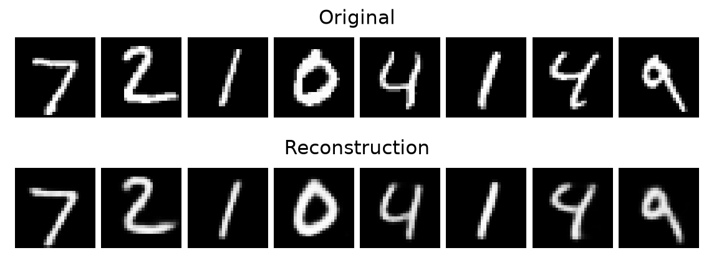
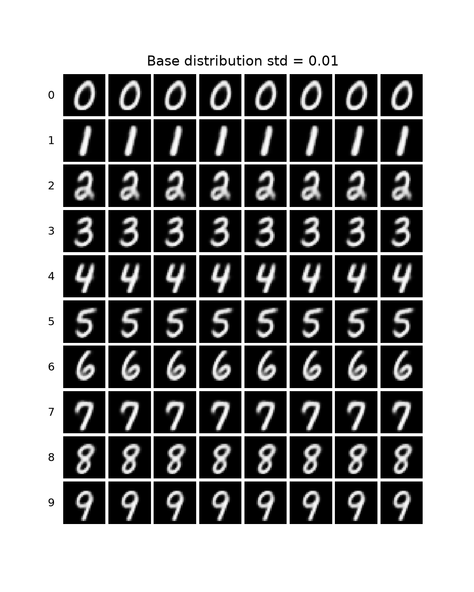
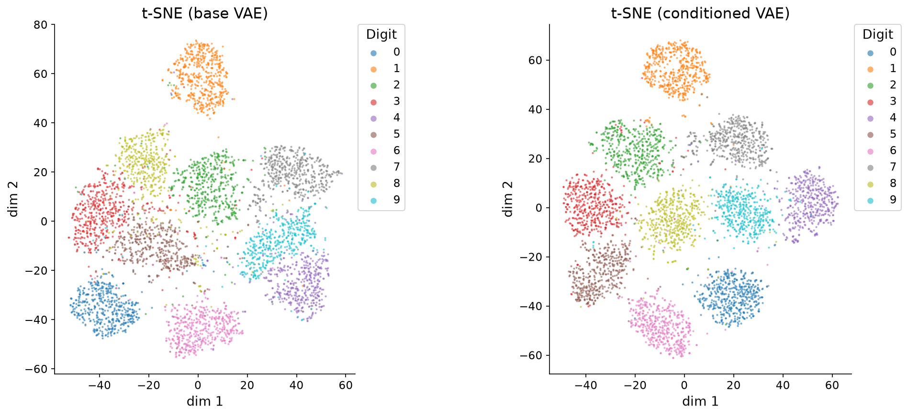
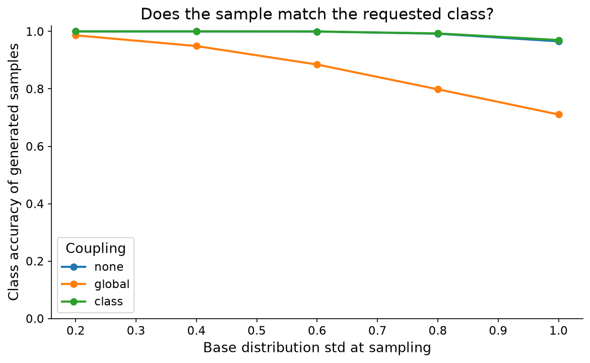
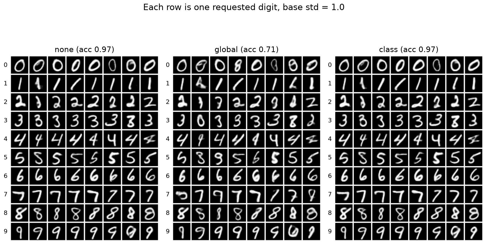
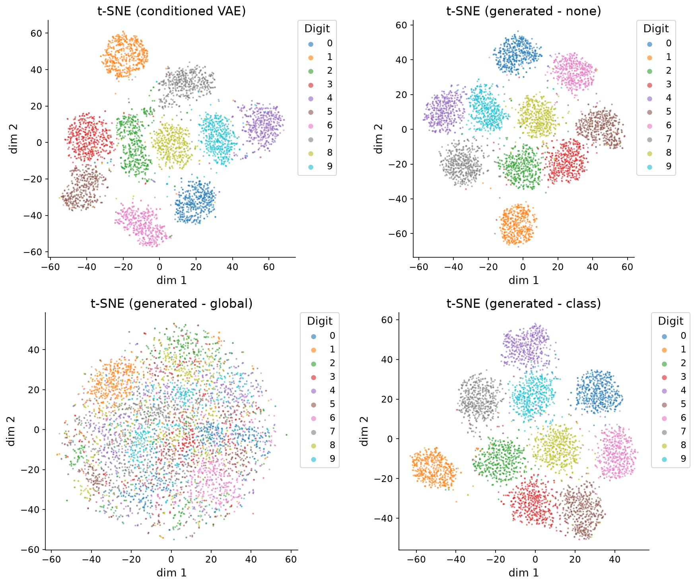

This is the second part of a series on learnings from implementing toy flow matching experiments. In [part 1](/2026/10/17/flow-matching-p1.html) I covered the basics: the base noise variance, the midpoint ODE solver, optimal transport (OT) coupling and a few ways of conditioning on class labels. This time I move the whole thing into the latent space of a VAE, and spend most of the post chasing down a bug that turned out not to be a bug in the code, but in my understanding of what OT coupling does to a conditional model.

The short version: **if you combine minibatch OT with class conditioning, the base distribution you train on is no longer a standard normal given the class, and sampling from a standard normal will mix up your classes.** The fix is either to drop OT or to solve the OT problem separately inside each class.

The code for all experiments is in the [flow-matching repository](https://github.com/sabalanya/flow-matching).

---

## 1. Flow Matching in a Latent Space

Instead of learning a velocity field over 784 pixels, we can first compress the images with a VAE and learn the flow over the latent code. Sampling then has three steps: draw noise, integrate the ODE in latent space, and decode with the VAE decoder.

The appeal is that the flow network becomes tiny. I used a 16-dimensional latent space, so the velocity field is a small MLP that takes $(z_t, t, \text{class embedding})$ and returns a 16-dimensional velocity, instead of a model that has to handle 784 pixel dimensions.

The VAE is a small convolutional encoder and decoder trained with the usual objective,

$$\mathcal{L} = \underbrace{\text{BCE}(x, \hat{x})}_{\text{reconstruction}} + \beta \, \text{KL}\big(q(z|x)\,\|\,\mathcal{N}(0, I)\big),$$

and the flow is trained on the encoder means $\mu(x)$. The data distribution $p_1$ of the flow is then the set of latent codes of the training images, labeled with their digit.

{:width="600"}

---

## 2. The Problem: Classes Get Mixed Up

I trained a class-conditional flow on the latent codes (with the same class embedding concatenation as approach 1 in part 1) and sampled ten rows, one per requested digit. As in part 1, I also varied the std of the base distribution at sampling time.

Two things happened, and only one of them was expected. Lowering the std reduced the diversity of the samples, as before. Raising it increased diversity, but not the way I wanted. I expected to see many styles of the requested digit, for example eight different 1s when asking for class 1. Instead, **the extra diversity came from the samples drifting into other classes.**

{:width="400"}

This is a clear failure of conditioning: the class label was supposed to pick the digit, and the noise was supposed to pick the style.

---

## 3. First Suspect: The VAE Latent Space

My first guess was that the VAE simply did not encode the class well enough. If the digits overlap in latent space, no flow can separate them cleanly.

To test this I made the VAE class-aware by adding a linear classifier head on top of $z$ and training it jointly with the VAE loss. Then I compared the t-SNE of the latent codes of the two VAEs.



The class-aware latent space is clearly better organized. A linear classifier trained on the encoder means jumps from about 92% to 97.5% test accuracy when pretraining the VAE with the class-aware objective, and 10-nearest-neighbors reaches increases from 96% to 98%. So the information is there. But when I retrained the flow on this latent space, the class mixing was still there at larger base std. The VAE was not the main problem.

---

## 4. The Real Culprit: OT Coupling Ignores the Class

The flow training loop I was using came straight from part 1, including the minibatch OT coupling:

```python
cost = distance.cdist(x_0.cpu().numpy(), x_1.cpu().numpy())
row_ind, col_ind = linear_sum_assignment(cost)
x_0, x_1_ot = x_0[row_ind], x_1[col_ind]
c = c[col_ind]
```

The last line is the important one. OT pairs each noise vector with the nearest data point in the batch, regardless of its class, and the label then follows the data point. So what the network sees during training is no longer a pair of independent variables. A noise vector $x_0$ only ever appears with the class of the data point it was matched to, which means

$$p_\text{train}(x_0 \mid c) \neq \mathcal{N}(0, \sigma^2 I).$$

The class and the noise are correlated, and the network is free to use the position of $x_0$ as a shortcut to figure out what the class is.

At sampling time, on the other hand, we pick a class $c$ and draw $x_0 \sim \mathcal{N}(0, \sigma^2 I)$ independently of it. That pair is out of distribution for the network: a combination of noise and class that it was never trained on. The larger the std, the more of the noise space we explore and the more often this happens, which is consistent with the mixing getting worse as the base std grows.

This is actually close to what happened in approach 3 of part 1, where I conditioned on the class through the base distribution. There, making the source depend on the class was the whole point. Here it happens by accident, and then I sampled as if it had not.

---

## 5. The Fix: Keep the Base Distribution Gaussian Given the Class

There are two ways to restore $p(x_0 \mid c) = \mathcal{N}(0, \sigma^2 I)$:

1. **No OT.** Pair noise and data independently, which is plain flow matching.
2. **Class-wise OT.** Solve the assignment problem separately inside each class in the batch. The noise never gets matched across classes, so it stays independent of the label, but we still get the shorter and straighter paths that OT gives.

```python
def class_ot_coupling(x_0, x_1, c):
    x_0_ot = x_0.clone()
    for k in c.unique():
        idx = (c == k).nonzero().squeeze(1)
        cost = distance.cdist(x_0[idx].cpu().numpy(), x_1[idx].cpu().numpy())
        row_ind, col_ind = linear_sum_assignment(cost)
        x_0_ot[idx[col_ind]] = x_0[idx[row_ind]]
    return x_0_ot
```

I trained three flows with identical architecture, seed and number of epochs, changing only the coupling: no OT, global OT (the original), and class-wise OT. To measure whether a sample really belongs to the requested class, I trained a small independent CNN on real MNIST and used it to classify the decoded samples.

{:width="600"}

| Base std | No OT | Global OT | Class-wise OT |
|---|---|---|---|
| 0.2 | 1.000  |  0.986  |  1.000 |
| 0.6 | 1.000  |  0.885  |  1.000 |
| 1.0 | 0.965  |  0.711  |  0.970 |

Global OT is clearly the worst of the three, and the gap grows with the base std. Both fixes recover class fidelity.



With the fix, asking for class 1 at a large std now gives different styles of 1 rather than other digits, which is what I originally expected from the noise. The better representation learned by the flows with class-wise OT and no OT is also visible in the t-SNE of the decoded samples, which shows tighter clusters for each digit.



---

## Takeaways

- **Minibatch OT changes the distribution of the noise given the label.** If the label follows the data point, the class-conditional base distribution is no longer Gaussian, and sampling from a Gaussian is a train/test mismatch.
- **Keep the noise independent of the condition.** Either skip OT or run it within each condition group.
- **Check the conditioning before blaming the representation.** My first instinct was to improve the VAE latent space, which helped the geometry but not the problem I actually had.
- **Capacity matters too.** In my tests, widening the flow MLP from 32 to 256 hidden units helped the sample quality at large std, even in a 16-dimensional space.
